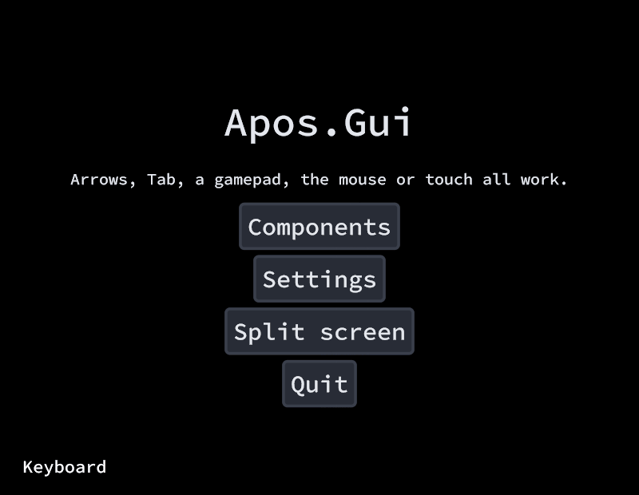

# Apos.Gui
UI library for MonoGame.

## Description

This library is designed to allow the creation of custom user facing UIs. You use it like an IMGUI, putting components every frame from your game's own variables, while the components themselves are kept from frame to frame so they can hold focus, scrolling and animations. It comes with the common components, and the pieces they're built from are public so that your own work the same way.

[](https://discord.gg/N9t26Uv)

## Documentation

* [Getting started](https://apostolique.github.io/Apos.Gui/getting-started/)
* [Components](https://apostolique.github.io/Apos.Gui/components/)
* [Layout](https://apostolique.github.io/Apos.Gui/layout/)
* [Identity](https://apostolique.github.io/Apos.Gui/identity/)
* [Focus](https://apostolique.github.io/Apos.Gui/focus/)
* [Input](https://apostolique.github.io/Apos.Gui/input/)
* [Looks](https://apostolique.github.io/Apos.Gui/looks/)
* [Custom components](https://apostolique.github.io/Apos.Gui/custom-components/)
* [Testing](https://apostolique.github.io/Apos.Gui/testing/)
* [Moving from 2.x](https://apostolique.github.io/Apos.Gui/migration/)

## Build

[](https://www.nuget.org/packages/Apos.Gui/) [](https://www.nuget.org/packages/Apos.Gui/)

## Features

* Mouse, touch, keyboard and gamepad, with arrow, d-pad and stick navigation that works on any layout
* Buttons, checkboxes, radio buttons, sliders, progress bars, textboxes, dropdowns, tabs, tooltips, popups
* Stacks with spacing, padding, alignment and scrolling
* Text wrapping, and textboxes with selection, copy and paste
* Themes, and looks you can replace per component
* One UI per player for split screen, UI scaling, and UIs drawn to render targets
* Hooks for the system clipboard and on-screen keyboards
* Used like IMGUI but components can be coded like a retained UI

## Showcase



## Usage Example

You can create a simple UI with the following code that you'll put in the Update call:

```csharp
MenuPanel.Push();
if (Button.Put("Show fun").Clicked) {
    _showFun = !_showFun;
}
if (_showFun) {
    Label.Put("This is fun!");
}
if (Button.Put("Quit").Clicked) {
    Exit();
}
MenuPanel.Pop();
```

This code will create 2 buttons, "Show Fun" and "Quit". You can use the mouse, touch, the keyboard or a gamepad to interact with them. Clicking on "Show Fun" will insert a label in between them with the text "This is fun!".

You can read more in the [Getting started](https://apostolique.github.io/Apos.Gui/getting-started/) guide.

## Other projects you might like

* [Apos.Input](https://github.com/Apostolique/Apos.Input) - Input library for MonoGame.
* [Apos.Camera](https://github.com/Apostolique/Apos.Camera) -  Camera library for MonoGame.
* [Apos.History](https://github.com/Apostolique/Apos.History) - A C# library that makes it easy to handle undo and redo.
* [Apos.Content](https://github.com/Apostolique/Apos.Content) - Content builder library for MonoGame.
* [Apos.Framework](https://github.com/Apostolique/Apos.Framework) - Game architecture for MonoGame.
