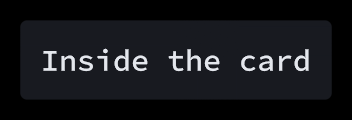

# Custom components

This guide will show you how to make your own components. The built-in ones are made the same way, so anything they do, yours can do too.

Most games end up with components that the library can't guess: a health bar made of hearts, an inventory slot, a dial. A [look](../looks/README.md) is enough to restyle a built-in one. For anything that behaves differently, write a component.

## A knob

Let's say you want a dial that turns when you drag it up and down, or with left and right while it has focus. The full code is in the example's [Knob.cs](https://github.com/Apostolique/Apos.Gui/blob/main/Example/Game/Knob.cs).


A component is a class that extends `Component`, with a `Put` method that your UI code calls:

```csharp
public class Knob(long id) : Component(id) {
    public float Value { get; set; }
    public Interaction Interaction { get; } = new();
    public override bool IsFocusable { get; set; } = true;

    public static Knob Put(ref float value, [CallerLineNumber] int id = 0, bool isAbsoluteId = false, [CallerFilePath] string file = "") {
        Knob k = IMGUI.Put(id, isAbsoluteId, file, id => new Knob(id));
        if (k.IsFocused) {
            value = k.Value;
        } else {
            k.Value = value;
        }
        return k;
    }
}
```

`IMGUI.Put` finds the knob from last frame, or creates it with the function you give it the first time, then adds it to the current parent. Forward `id`, `isAbsoluteId` and `file` as they are. [Identity](../identity/README.md) explains what they do.

The `ref` value follows the same rule as the built-in components. While the knob has focus it owns the value, otherwise it copies yours.

## Input

`UpdateInput` runs once per frame, before your UI code. `Interaction` does the work for the mouse, touch and the focus button: hover, press, click, drag, capturing the pointer while pressed, and giving focus.

```csharp
public override void UpdateInput(GameTime gameTime) {
    Interaction.UpdateInput(this);

    if (Interaction.Pressed && Interaction.Source != InteractionSource.Button) {
        Value = MathHelper.Clamp(Value - Interaction.Delta.Y / 200f, 0f, 1f);
    }
    if (IsFocused) {
        if (Root.Bindings.MoveLeft.Pressed()) Value = MathHelper.Clamp(Value - 0.05f, 0f, 1f);
        if (Root.Bindings.MoveRight.Pressed()) Value = MathHelper.Clamp(Value + 0.05f, 0f, 1f);
    }
}
```

Components get `UpdateInput` from the top of the draw order down, so the one drawn on top gets the mouse first. Reading the UI's `Bindings` through `Root` keeps your component working in [split screen](../input/README.md#split-screen). Consuming `MoveLeft` and `MoveRight` here is what stops them from also moving the focus.

## Size and drawing

`UpdatePrefSize` says how big the component would like to be. The parent then sets `X`, `Y`, `Width` and `Height`, which might not be what it asked for.

Some components want a size that depends on the size they get, like text that wraps: a narrower width means more lines, so a taller component. Those can call `Root.InvalidateLayout()` when their width changes, and the UI lays out again in the same frame. `Paragraph` does that.

```csharp
public override void UpdatePrefSize(GameTime gameTime) {
    PrefWidth = 70f;
    PrefHeight = 70f;
}

public override void Draw(GameTime gameTime) {
    Vector2 center = XY + Size / 2f;
    float radius = MathF.Min(Width, Height) / 2f;
    GuiHelper.ShapeBatch.BorderCircle(center, radius, IsFocused ? Theme.Focus : Theme.Border, Theme.BorderThickness);
    // ...
}
```

Reading `Theme` makes the component match the rest of the UI. Adding a `Look` property like the built-in components have lets games restyle it without subclassing.

## Components with children

For a component that holds others, extend `SingleParent` for one child or `ListParent` for any number. Here's a card with a background and some padding:

```csharp
public class Card(long id) : SingleParent(id) {
    public float Padding { get; set; } = 10f;

    public override void UpdatePrefSize(GameTime gameTime) {
        base.UpdatePrefSize(gameTime);
        PrefWidth += Padding * 2f;
        PrefHeight += Padding * 2f;
    }
    public override void UpdateLayout(GameTime gameTime) {
        if (Child != null) {
            Child.Bounds = new RectangleF(X + Padding, Y + Padding, Width - Padding * 2f, Height - Padding * 2f);
            LayoutChild(gameTime);
        }
    }
    public override void Draw(GameTime gameTime) {
        GuiHelper.ShapeBatch.FillRectangle(XY, Size, Theme.Panel, Theme.Rounding);
        base.Draw(gameTime);
    }

    public static Card Push([CallerLineNumber] int id = 0, bool isAbsoluteId = false, [CallerFilePath] string file = "") {
        return IMGUI.Push(id, isAbsoluteId, file, id => new Card(id), maxChildren: 1);
    }
}
```

`IMGUI.Push` is `IMGUI.Put` that also makes the component the current parent. With `maxChildren: 1` it pops itself after its child, so it's used like a button:

```csharp
Card.Push();
Label.Put("Inside the card");
```



`LayoutChild` sets the child's clip and lays out its own children. For a parent with no limit, add a `Pop` method that calls `GuiHelper.CurrentIMGUI.Pop()`.

A `ListParent` keeps its children in `_children`, in the order they were put. `StackPanel` is a good example of a `ListParent` that arranges them.

## Testing

A component can be tested without a window. [Testing](../testing/README.md) shows how.
