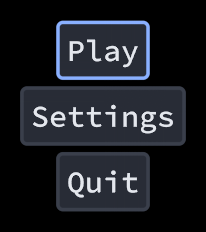

# Focus

This guide will show you how the focus moves between components, and how to change where it goes.

One component per UI has focus. It's the one that the keyboard and the gamepad talk to: a focused button gets pressed by Enter or A, a focused slider moves with left and right, a focused textbox gets the typing. Pressing a component with the mouse or touch gives it focus too.

You can give focus yourself, for example to the first button of a screen that just opened:

```csharp
Button play = Button.Put("Play");
if (_justOpened) {
    _ui.GrabFocus(play);
    _justOpened = false;
}
```



`_ui.GrabFocus(null)` clears it.

## Tab

Tab goes to the next focusable component in the order you put them, and Shift+Tab to the previous one. It goes through everything in the UI.

## Arrows, the d-pad and the left stick

The arrow keys, the d-pad and the left stick move the focus in a direction. Only components that start past the focused one's edge count.

Up and down go to the next row, then to the component in that row that's the most in line with the focused one. So moving down a menu stops at every row, even when a row is off center.

Left and right stay in the row. The closest component wins, and being above or below counts a lot more than being far. So moving right in a row of radio buttons goes to the next one, even when something in the row above is closer.

In a grid, both of those go to the neighbor.

The focused component gets the arrows first. A slider uses left and right, and a textbox uses left and right to move its caret, so those don't move the focus. Up and down still do, unless the textbox is multiline. Holding a direction repeats it.

When nothing has focus, any direction focuses the first component.

## Focus scopes

Popups and floating windows are focus scopes. Once the focus is inside one, the arrows and the d-pad only go to the components in it. That keeps a gamepad player from wandering out of a dialog into the menu behind it. Tab still goes everywhere.

A focused floating window lets the focus in: pressing any direction focuses its first component.

Any stack can be a scope:

```csharp
Vertical.Push().IsFocusScope = true;
```

## Custom navigation

Some layouts need a different rule, like a menu that wraps from the last item to the first, or a radial menu. A parent can pick the target itself by overriding `Navigate`:

```csharp
public class WrappingRow(long id) : Horizontal(id) {
    public override IComponent? Navigate(IComponent from, Direction direction) {
        if (direction == Direction.Right && from == _children[^1]) return _children[0];
        if (direction == Direction.Left && from == _children[0]) return _children[^1];
        return null;
    }
}
```

The focused component's parents get asked from the closest one up to its focus scope. Returning null lets the next parent decide, and when they all return null the default rule picks. `Navigation.Closest` is that default rule, so a parent can also run it on its own list of candidates.

## Changing the keys

The keys and buttons are in the UI's `Bindings`. [Input](../input/README.md) shows how to change them.
