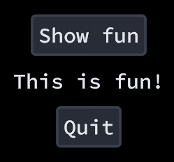

# Getting started

This guide will show you how to put a menu on screen that works with the mouse, the keyboard, a gamepad and touch.

## Install

Install using the following dotnet command:

```
dotnet add package Apos.Gui
```

For KNI, use `Apos.Gui.KNI` instead.

## Setup

Import the library with:

```csharp
using Apos.Gui;
using Apos.Shapes;
```

Find a font ttf file, call it `font-file.ttf` and put it in your content folder. Add it to the MonoGame content pipeline and select ***copy*** in "Build Action" instead of ~~build~~.

In your game's `LoadContent()`, give your game instance and your font to `GuiHelper`, then create an `IMGUI`:

```csharp
protected override void LoadContent() {
    using var fontStream = TitleContainer.OpenStream($"{Content.RootDirectory}/font-file.ttf");
    GuiHelper.Setup(this, new ShapeFont(fontStream));

    _ui = new IMGUI();
}

IMGUI _ui;
```

`GuiHelper.Setup` also sets up [Apos.Input](https://apostolique.github.io/Apos.Input/), which Apos.Gui reads its input from.

## The update loop

The UI is rebuilt every frame from your own variables. Put your components between `UpdateStart` and `UpdateEnd`:

```csharp
protected override void Update(GameTime gameTime) {
    GuiHelper.UpdateSetup(gameTime);
    _ui.UpdateStart(gameTime);

    MenuPanel.Push();
    if (Button.Put("Show fun").Clicked) {
        _showFun = !_showFun;
    }
    if (_showFun) {
        Label.Put("This is fun!");
    }
    if (Button.Put("Quit").Clicked) {
        Exit();
    }
    MenuPanel.Pop();

    _ui.UpdateEnd(gameTime);
    GuiHelper.UpdateCleanup();

    base.Update(gameTime);
}

bool _showFun = false;
```

`MenuPanel` fills the window and centers what's in it. Clicking "Show fun" puts a label between the two buttons, and clicking it again takes it away.



The components remember their state from one frame to the next even though you call `Put` every frame. [Identity](../identity/README.md) explains how.

## The draw loop

```csharp
protected override void Draw(GameTime gameTime) {
    GraphicsDevice.Clear(Color.Black);

    _ui.Draw(gameTime);

    base.Draw(gameTime);
}
```

## Moving around

Without any setup:

* The mouse and touch press whatever is under them.
* The arrow keys, the d-pad and the left stick move the focus to the closest component in that direction.
* Tab and Shift+Tab go through the components in the order you put them.
* Space, Enter and the gamepad's A button press the focused component.
* Escape and the gamepad's B button close popups.

[Focus](../focus/README.md) and [Input](../input/README.md) show how to change all of that.

## Read more

* [Components](../components/README.md) lists what comes with the library.
* [Layout](../layout/README.md) shows how to arrange them.
* [Custom components](../custom-components/README.md) shows how to make your own.
* The [example](https://github.com/Apostolique/Apos.Gui/tree/main/Example) uses everything in these guides.
