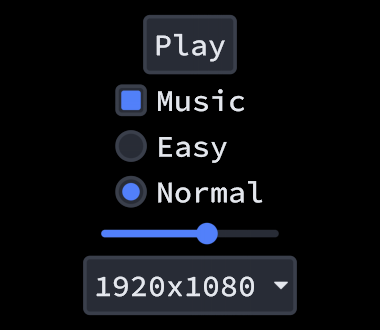
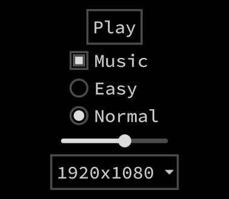
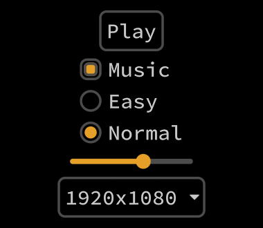
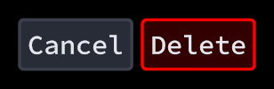

# Looks

This guide will show you how to change the way the built-in components draw.

## Theme

`Theme` holds the colors and sizes that every built-in look reads. It comes with two presets:

```csharp
Theme.UseFilled();  // Filled surfaces, rounded corners and a blue accent. This is the default.
Theme.UseOutline(); // Thin borders on black.
```

 

You can start from one and change what you want:

```csharp
Theme.UseOutline();
Theme.Accent = new Color(230, 160, 40);
Theme.Rounding = 10f;
```



`Surface` fills buttons, boxes, tracks and title bars, and transparent leaves only their borders. `Panel` is behind popups, windows and tooltips. `Accent` is what's on or picked: checkmarks, the filled part of bars, slider thumbs, the selected tab and selected text. `Focus` is the border of the focused component. `Highlight` fades in on hover and press, and `Backdrop` darkens the screen behind a modal popup. Changes show up on the next draw.

## Looks

Each built-in component draws through a look, a function that gets the component and draws it with `GuiHelper.ShapeBatch`. You can replace it for one component:

```csharp
Button danger = Button.Put("Delete");
danger.Look = b => {
    float glow = 0.2f + 0.3f * b.Interaction.Hover + 0.3f * b.Interaction.Press;
    GuiHelper.ShapeBatch.FillRectangle(b.XY, b.Size, new Color(Color.Red, glow), Theme.Rounding);
    GuiHelper.ShapeBatch.BorderRectangle(b.XY, b.Size, b.IsFocused ? Theme.Focus : Color.Red, Theme.BorderThickness, Theme.Rounding);
};
```



Or for every component of that type:

```csharp
Button.DefaultLook = DrawMyButton;
```

A button's look draws under its child, so the label still draws on top.

`Interaction.Hover` and `Interaction.Press` go from 0 to 1 and back over a short time. They're there so that a look can animate without keeping its own timers. `Clicked`, `IsFocused` and `Interaction.Pressed` are there for everything else.

Every UI animation and delay runs on `GuiHelper.Clock`, which `GuiHelper.UpdateSetup` moves forward. It's not the clock that [Apos.Tweens](https://github.com/Apostolique/Apos.Tweens) uses by default, so a game that pauses its own tweens with `TweenHelper.Clock.Scale = 0f` still has a pause menu that moves. Its `Scale` slows down or speeds up the whole UI:

```csharp
GuiHelper.Clock.Scale = 0.5f;
```

`Button.DrawPressable` is the highlight and border that the built-in clickable components share. It's a good start for a look that only adds something.

## Textures

A look can draw anything, including textures. `GuiHelper.ShapeBatch` is an [Apos.Shapes](https://github.com/Apostolique/Apos.Shapes) `ShapeBatch`, and it draws textures in the same batch as the shapes, clipped the same way:

```csharp
danger.Look = b => {
    Vector2 scale = b.Size / new Vector2(_buttonTexture.Width, _buttonTexture.Height);
    GuiHelper.ShapeBatch.Draw(_buttonTexture, b.XY, Color.White, 0f, Vector2.Zero, scale);
};
```

Don't end the batch to draw with a `SpriteBatch` in the middle of a look. The clips only apply to the `ShapeBatch`, so what the `SpriteBatch` draws would spill out of a stack that scrolls.
